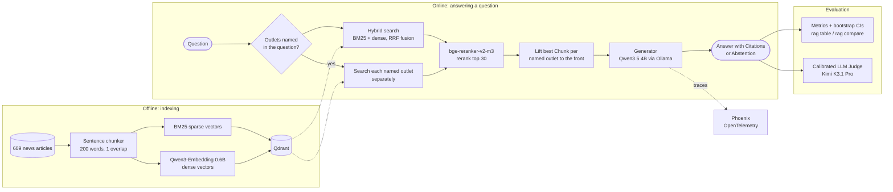

# RAG Pipeline: a measured Ablation Ladder on MultiHop-RAG

[](https://github.com/ethereal-ctrl/rag-pipeline/actions/workflows/ci.yml)


**Which RAG techniques actually pay off on multi-hop questions?** This project builds a
retrieval-augmented QA pipeline one rung at a time and measures every rung on
[MultiHop-RAG](https://arxiv.org/abs/2401.15391), with 95% confidence intervals. It runs
fully local on a 16 GB MacBook and costs nothing. Every design choice was made on the Dev
Split. The final numbers come from 600 Test Split questions that were never looked at before.

## Highlights

- **0.445 → 0.775 accuracy** from no retrieval to the chosen pipeline, with a 4B model
  running locally.
- **A cheap lever beat the agent.** Lifting the articles of the outlets named in the question
  adds +0.053 at +2 s per question. An agentic search loop adds +0.027 at +32 s.
- **Retrieval makes the model honest.** Without retrieval it invents an answer for 98.6% of
  unanswerable questions. With retrieval it says "insufficient information" for 85–96%.
- **Honest evaluation.** The tables also report coverage, accuracy on answered questions, a
  score that punishes wrong answers, an "always Yes" baseline and an LLM Judge that was
  calibrated against human labels first.

## Architecture



The core is plain Python with no orchestration framework (ADR 0004), so every step above is
a few readable functions in [`src/rag_pipeline/variants.py`](src/rag_pipeline/variants.py).
Each rung of the ladder is a YAML config that switches one of these steps on.

## Results

Qwen3.5 4B, 600 untouched Test Split questions, accuracy with a 95% interval.

| Rung | What it adds | Accuracy [95% CI] | Null Queries abstained |
|---|---|---:|---:|
| Always "Yes" | trivial baseline | 0.325 [0.287, 0.363] | 0.000 |
| Closed-Book | no retrieval | 0.445 [0.403, 0.483] | 0.014 |
| BM25 | keyword search | 0.665 [0.628, 0.703] | 0.930 |
| Dense | embedding search | 0.613 [0.573, 0.650] | 0.901 |
| Hybrid | BM25 + dense, RRF | 0.685 [0.648, 0.720] | 0.859 |
| + Reranker | cross-encoder reranking | 0.722 [0.688, 0.760] | 0.887 |
| Agentic Search | sub-queries in a loop | 0.747 [0.710, 0.783] | 0.958 |
| **+ source-aware retrieval** | **named outlets lifted (chosen)** | **0.775 [0.742, 0.807]** | 0.845 |
| Oracle retrieval | gold Evidence in context | 0.855 [0.827, 0.883] | 0.972 |

What the numbers say:

1. **BM25 beats dense retrieval on news** (−0.052, significant). Questions hinge on names,
   outlets and dates, where exact term match is strong.
2. **Citations cost accuracy.** Requiring cited, supported statements lowers accuracy by
   0.070 through more cautious abstentions. The answers it gives are more often right.
3. **The headroom is in retrieval.** With gold Evidence in the context, the same 4B model
   reaches 0.855. That is 8 points lost in retrieval.
4. **A bigger model is not automatically better.** Gemma 4 31B (NVIDIA NIM) reaches 0.712
   with the same levers. It never answers an unanswerable question but abstains far more on
   answerable ones, so it wins only when wrong answers are punished hard.
5. **The substring match holds up.** The calibrated Judge (κ 0.889 on correctness) re-grades
   the chosen variants at 0.792 (4B) and 0.735 (Gemma). The ranking does not change.

Full tables, paired comparisons and the Gemma, Router and Judge results:
[docs/report/ladder-test-600.md](docs/report/ladder-test-600.md).

## How the evaluation stays honest

| Rule | Why |
|---|---|
| Fixed splits: Dev (500) to decide, Test to measure ([ADR 0005](docs/adr/0005-fixed-splits-test-scored-once.md)) | No tuning on the numbers that get reported |
| Each variant is scored on Test once, enforced in code | Prevents quiet re-runs until a number looks good |
| Final scores on 600 questions no analysis has seen ([ADR 0008](docs/adr/0008-final-scores-on-the-untouched-600.md)) | The other 400 were used for error analysis |
| Paired bootstrap for every difference | "Significant" means the 95% interval excludes zero |
| Null Queries count only when the model abstains | Inventing an answer to an unanswerable question is wrong |
| LLM Judge calibrated against human labels first ([report](docs/report/judge-calibration.md)) | Trusted only where it agrees (correctness yes, support no) |

## Quickstart

You need Docker, [Ollama](https://ollama.com) and [uv](https://docs.astral.sh/uv/).

```bash
ollama pull qwen3.5:4b && ollama pull bge-m3
docker compose up -d                          # API, Qdrant and Phoenix
docker compose run --rm api rag bootstrap     # fetch the dataset, build the demo index
```

The demo defaults to the cited Hybrid + Reranker variant. Open it at <http://localhost:8000>, ask a question and expand a Citation to see the
source text. Each answer's trace is in Phoenix at <http://localhost:6006>.

Run an evaluation:

```bash
uv sync
uv run rag data fetch                                   # pinned, checksum-verified
uv run rag ingest --variant-file configs/variants/bm25.yaml
uv run rag eval configs/variants/bm25.yaml --split smoke
uv run rag table RUN_ID --always-yes                    # metrics with 95% intervals
uv run rag compare RUN_A RUN_B                          # paired comparison
```

All commands, providers and variants are documented in the
[operations guide](docs/guide.md).

## Tech stack

| Part | Choice |
|---|---|
| Generator | Qwen3.5 4B via Ollama (local). Gemma 4 31B via NVIDIA NIM for comparison |
| Embeddings | Qwen3-Embedding 0.6B (chosen in a bake-off over the 4B model) |
| Reranker | BAAI bge-reranker-v2-m3 |
| Search | Qdrant: dense, BM25 and Reciprocal Rank Fusion in one query |
| Judge | Kimi K3.1 Pro via NVIDIA NIM, calibrated against human labels |
| Serving | FastAPI demo with clickable Citations, Docker Compose |
| Observability | OpenTelemetry traces in Arize Phoenix |
| Quality | pytest, ruff, pyright. CI runs a retrieval gate on the Smoke Set without an LLM |

## Repository layout

```text
src/rag_pipeline/   pipeline core, evaluation, Judge, Router, CLI and demo API
configs/            one YAML per Pipeline Variant, ladder, Router and Judge configs
data/               fixed splits, Judge sample and calibration labels
docs/report/        final reports: ladder, Judge calibration, Router, bake-offs
docs/adr/           architecture decisions
docs/guide.md       operations guide with every command
tests/              seam tests with a fixture Corpus and fake models, no network
```

Vocabulary such as Pipeline Variant, Null Query or Evidence is defined in
[GLOSSARY.md](GLOSSARY.md).

## Development

```bash
uv run pytest
uv run ruff check src tests
uv run pyright
uv run rag gate      # Smoke Set retrieval metrics vs. committed thresholds
```

Every pull request runs lint, type checks and tests, then a retrieval gate. CI builds the
index with a small CPU embedder in a Qdrant service container, scores BM25 and Hybrid
retrieval on the Smoke Set and fails if a metric drops below `configs/gate/gate.yaml`.

## Data

MultiHop-RAG by Yixuan Tang and Yi Yang (arXiv:2401.15391), used under the
[ODC-BY 1.0](https://opendatacommons.org/licenses/by/1-0/) licence, pinned to Hugging Face
revision `71ac0d0b` of `yixuantt/MultiHopRAG`.
